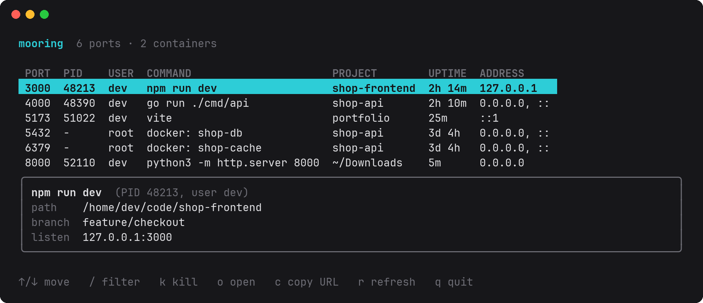
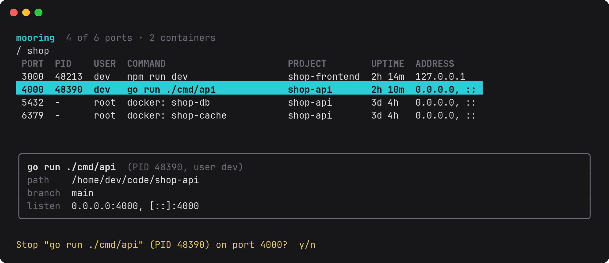

# Mooring

[](https://github.com/tauseef-creator/mooring/actions/workflows/ci.yml)

See who's tied up on your ports: which process, which project, and for how long.



## Usage

Run `mooring` for the interactive view above, or `mooring list` for a plain table:

```
$ mooring list
PORT   PID     USER   COMMAND       PROJECT         UPTIME   ADDRESS
3000   48213   me     npm run dev   shop-frontend   2h 14m   127.0.0.1
8765   51022   me     python3 -m…   ~/Downloads     5m       0.0.0.0
```

Run `mooring` on its own to browse the same table interactively. It
refreshes every 2 seconds and shows the full command, path, git branch and
addresses of the selected port. When its output is piped, `mooring` prints
the table instead.

| Key     | Action                                                        |
|---------|---------------------------------------------------------------|
| ↑ / ↓   | move the selection                                            |
| `/`     | filter: every word must appear in the row (`docker 44`, `main`) |
| `enter` | keep the filter and go back to the table                      |
| `esc`   | clear the filter, or quit when there is none                  |
| `k`     | stop the selected port, after a y/n prompt (like `mooring kill`) |
| `o`     | open the port in your browser (`http://localhost:PORT`)       |
| `c`     | copy the port's URL to the clipboard                          |
| `r`     | refresh now                                                   |
| `q`     | quit                                                          |



Linux only for now. Mooring reads `/proc` directly and needs no other tools.

## Free a port

```
$ mooring kill 3000
Stop "npm run dev" (PID 48213) on port 3000? [y/N] y
Stopped "npm run dev" (PID 48213) on port 3000
```

Processes get SIGTERM, then SIGKILL if they are still running after
`-timeout` (default 10s, the same as `docker stop`). A port published by a
container stops the container through Docker or Podman instead. Pass `-y`
to skip the prompt; without a terminal, mooring refuses unless you do.

## Install

Download a prebuilt binary for Linux (amd64 or arm64) from the
[latest release](https://github.com/tauseef-creator/mooring/releases/latest).
It is a single static file with no dependencies:

```
tar -xzf mooring_*_linux_amd64.tar.gz mooring
sudo install mooring /usr/local/bin/
mooring --version
```

Or install with Go 1.26 or later:

```
go install github.com/tauseef-creator/mooring@latest
```

Or build from source:

```
git clone https://github.com/tauseef-creator/mooring.git
cd mooring
go build -o mooring .
```

## Environment

| Variable    | Default | Purpose                                 |
|-------------|---------|-----------------------------------------|
| `HOST_PROC` | `/proc` | procfs mount point                      |
| `HOST_ROOT` | `/`     | filesystem root for finding projects    |
| `DOCKER_HOST` | `unix:///var/run/docker.sock` | Docker API socket |
| `CONTAINER_HOST` | rootless, then rootful Podman socket | Podman API socket |

## Containers

Ports published by Docker or Podman containers show the container name,
its Compose project folder and its uptime. Mooring reads this from the
engine's API socket, so you need access to it (for Docker, membership in
the `docker` group). Rootless Podman needs its API socket enabled:

```
systemctl --user enable --now podman.socket
```
