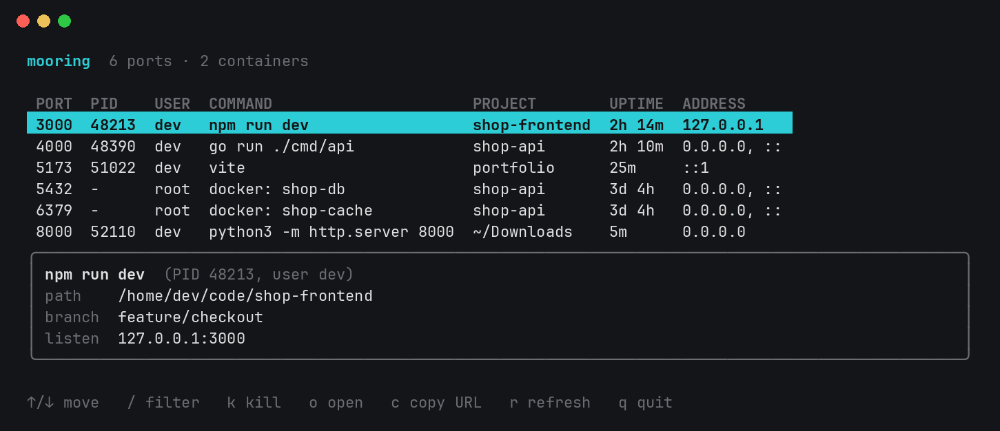

# Mooring

[](https://github.com/tauseef-creator/mooring/actions/workflows/ci.yml)
[](https://github.com/tauseef-creator/mooring/releases/latest)
[](LICENSE)

See what's running on your ports: the process, the project it belongs to, and how long it has been up. Stop it without hunting for PIDs.



```
Error: listen EADDRINUSE: address already in use :::3000
```

The usual fix is `lsof -i :3000`, copying a PID, running `kill`, and hoping it was the right process. `lsof` tells you a PID and a command name like `node`. Mooring tells you it's `npm run dev` in `shop-frontend` on branch `feature/checkout`, started two hours ago.

## Features

- **Projects, not just PIDs.** Each port is matched to its process, working directory and git repository, including the current branch.
- **Containers by name.** Ports published by Docker or Podman show the container, its image and its Compose project, instead of an anonymous `docker-proxy`.
- **Stops things safely.** Processes get SIGTERM, then SIGKILL only if they ignore it. Containers are stopped through their engine. Mooring re-checks each PID right before signaling, so a PID reused by another process is never hit.
- **Interactive or scriptable.** Browse and filter in the terminal UI, or use `mooring list` and `mooring kill` in scripts.
- **No dependencies.** A single static binary that reads `/proc` directly. No `lsof`, `ss` or root needed for your own processes.

## Install

Download a prebuilt binary for Linux (amd64 or arm64) from the
[latest release](https://github.com/tauseef-creator/mooring/releases/latest):

```
tar -xzf mooring_*_linux_amd64.tar.gz mooring
sudo install mooring /usr/local/bin/
mooring --version
```

Or install with Go 1.26 or later:

```
go install github.com/tauseef-creator/mooring@latest
```

## Usage

### Interactive

Run `mooring` to browse listening ports. The view refreshes every 2 seconds, and the panel shows the full command, path, branch and addresses of the selected port.

| Key     | Action                                                     |
|---------|------------------------------------------------------------|
| ↑ / ↓   | move the selection                                         |
| `/`     | filter: every word must match (`docker 44`, `main`)        |
| `enter` | keep the filter and go back to the table                   |
| `esc`   | clear the filter, or quit when there is none               |
| `k`     | stop the selected port, after a y/n prompt                 |
| `o`     | open the port in your browser                              |
| `c`     | copy the port's URL                                        |
| `r`     | refresh now                                                |
| `q`     | quit                                                       |

### Table

```
$ mooring list
PORT   PID     USER   COMMAND            PROJECT         UPTIME   ADDRESS
3000   48213   dev    npm run dev        shop-frontend   2h 14m   127.0.0.1
5432   -       root   docker: shop-db    shop-api        3d 4h    0.0.0.0, ::
8000   52110   dev    python3 -m htt…    ~/Downloads     5m       0.0.0.0
```

In a terminal, the table shrinks to fit the window. When piped, as in `mooring list | grep docker`, lines keep their full length. Running `mooring` with piped output prints this table too.

### Free a port

```
$ mooring kill 3000
Stop "npm run dev" (PID 48213) on port 3000? [y/N] y
Stopped "npm run dev" (PID 48213) on port 3000
```

Processes that are still running after `-timeout` (default 10s, the same as `docker stop`) get SIGKILL. Pass `-y` to skip the prompt. Without a terminal, `mooring kill` refuses unless `-y` is given, so a script cannot stop something by accident.

## How it works

Mooring reads the kernel's socket tables in `/proc/net/tcp` and `/proc/net/tcp6`, then matches each listening socket to the process holding it through `/proc/<pid>/fd`. The project comes from the process's working directory and the nearest `.git`, whose `HEAD` is read directly, so git does not need to be installed. Container details come from the Docker Engine API over its Unix socket, which Podman also provides.

## Limitations

- Linux only for now.
- TCP listeners only; UDP ports are not shown.
- Ports owned by other users' processes show as `-` unless you run Mooring with `sudo`.
- Container names need access to the engine's socket: for Docker, membership in the `docker` group. Rootless Podman needs its API socket enabled with `systemctl --user enable --now podman.socket`.

## Configuration

| Variable         | Default                              | Purpose                              |
|------------------|--------------------------------------|--------------------------------------|
| `HOST_PROC`      | `/proc`                              | procfs mount point                   |
| `HOST_ROOT`      | `/`                                  | filesystem root for finding projects |
| `DOCKER_HOST`    | `unix:///var/run/docker.sock`        | Docker API socket                    |
| `CONTAINER_HOST` | rootless, then rootful Podman socket | Podman API socket                    |

## License

[MIT](LICENSE)
